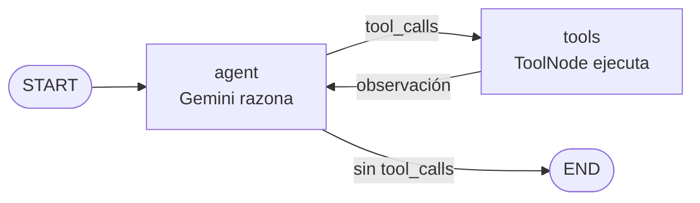

# Agente de análisis de ventas (LangGraph + Gemini)

Agente de razonamiento cíclico (ReAct) con **memoria persistente** en SQLite. Responde preguntas sobre un CSV de ventas ficticio usando herramientas propias, se corrige solo cuando una herramienta falla y recuerda la conversación entre ejecuciones gracias al `thread_id`.

## Arquitectura



- `graph.py`: `StateGraph` con `AgentState` (`messages` + reducer `add_messages`), nodo `agent`, nodo `tools` y arista condicional `tools_condition`. **No hay if/else manual**: el LLM decide si llama herramientas o responde.
- `tools.py`: 3 herramientas propias async con docstring y tipos: `listar_catalogo`, `consultar_ventas`, `calcular_variacion`.
- `main.py`: CLI async; usa `AsyncSqliteSaver` (SQLite) como checkpointer.
- `registro_traza.py`: guarda la traza ReAct en `traces/*.json` y `traces/*.log`.
- `tests/`: pruebas offline con un modelo simulado.

## Criterios de la consigna

| Criterio | Dónde se cumple |
|---|---|
| Autonomía | `add_conditional_edges("agent", tools_condition)`: el modelo decide el camino. |
| Ciclo de retorno | `consultar_ventas` devuelve `ERROR: ... Valores válidos: ...`; el agente lee el error, corrige y reintenta (ver traza y `test_ciclo_de_retorno_reintenta_tras_error`). El prompt también le indica pedir aclaración si no puede resolverlo. |
| Resiliencia de estado | `thread_id` + SQLite (`data/checkpoints.sqlite`): al reiniciar el programa con el mismo `thread_id` recuerda lo anterior (`test_memoria_persistente_entre_sesiones`). |
| Código limpio | Python 3.12, type hints, `asyncio`, `recursion_limit=12`, recorte de contexto (`trim_messages`). |

## Cómo replicarlo (Windows PowerShell)

```powershell
git clone https://github.com/JuanFa22/agente-ventas-langgraph.git
cd agente-ventas-langgraph
py -3.12 -m venv .venv
.\.venv\Scripts\Activate.ps1
pip install -r requirements.txt
copy .env.example .env      # luego abrí .env y pegá tu GOOGLE_API_KEY
python -m pytest -q         # tests offline (no necesitan clave)
python main.py --demo       # conversación de 3 turnos con Gemini
```

Probar la memoria persistente: cerrá y volvé a ejecutar con el mismo hilo:

```powershell
python main.py --thread-id ana --pregunta "Quiero analizar Alfajor Triple en la región Centro"
python main.py --thread-id ana --pregunta "¿Cuántas unidades vendió en 2026-02?"
```

La segunda pregunta no repite el producto ni la región: el agente los recupera del checkpoint.

## Traza del razonamiento

Cada turno genera en `traces/` un `.json` (estructurado) y un `.log` (legible) con los pasos `PENSAR → ACTUAR → OBSERVAR → RESPUESTA`. Se incluyen las trazas de la demo como evidencia.

## Datos

`data/ventas.csv` es ficticio (3 productos, 2 regiones, enero–marzo 2026).
